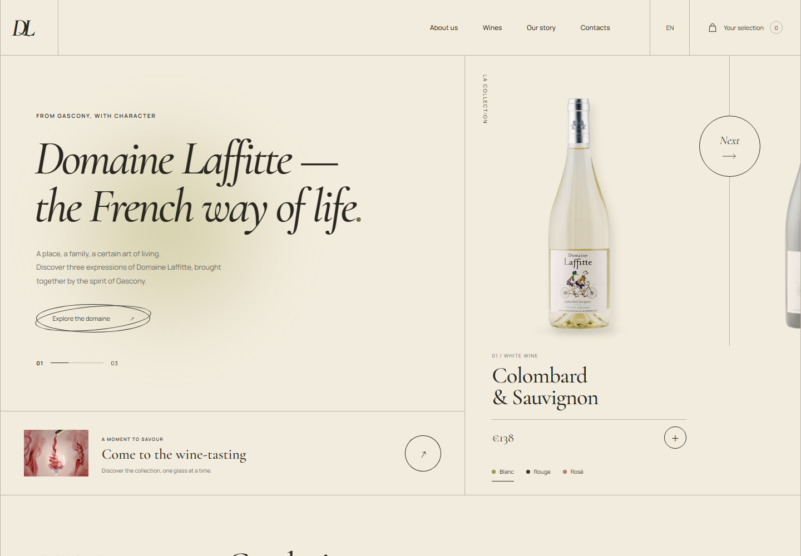
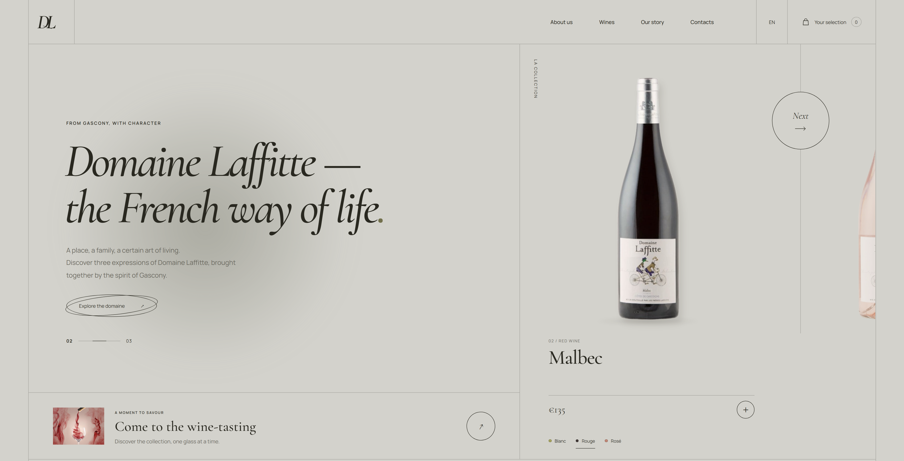
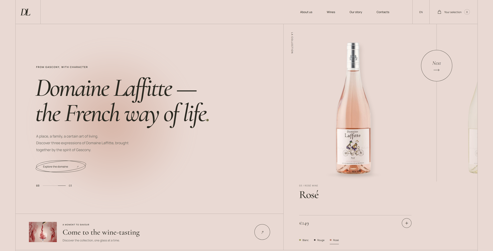
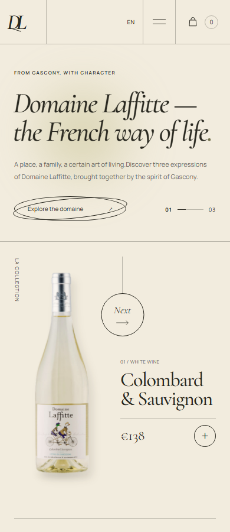
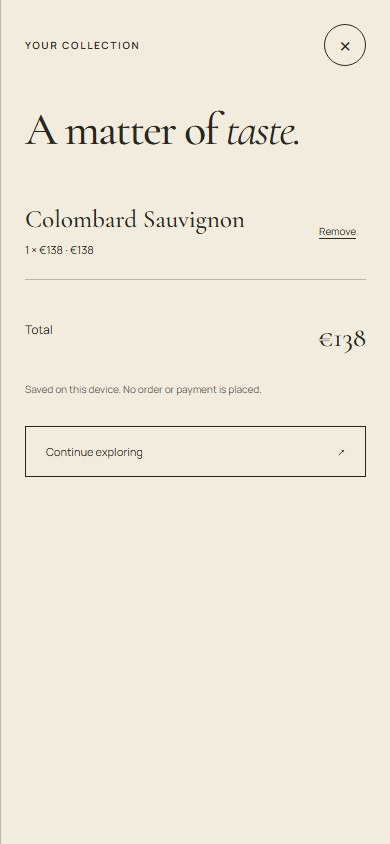

# Domaine Laffitte - лендинг винной коллекции

Адаптивный лендинг по концепции Figma: три вина в одной карусели, согласованные размеры бутылок и круглая кнопка переключения.

[Открыть сайт](https://memorim.github.io/domaine-laffitte-wine-landing/) · [Макет Figma](https://www.figma.com/design/jJ4Elc8tU9uAWlCB61WZYU/) · [Проверки CI](https://github.com/memorim/domaine-laffitte-wine-landing/actions)



## Возможности

- Colombard Sauvignon, Malbec и Rosé: цвета, подписи, цены и превью следующей бутылки меняются вместе.
- Одинаковая видимая высота и базовая линия бутылок без растягивания по ширине.
- Полная круглая область наведения и фокуса; декоративная линия не перехватывает нажатия.
- Выбор вина напрямую, стрелки клавиатуры, Home/End и быстрые последовательные переключения.
- Локальная коллекция с количеством, суммой, удалением и сохранением; ошибки и недоступность хранилища обрабатываются.
- Мобильное меню, ссылки разделов, нативный диалог, возврат фокуса и режим уменьшенной анимации.
- Адаптация от 320 px. Фотографии бутылок, изображение дегустации и шрифты размещены локально.

| Malbec                                | Rosé                                   |
| ------------------------------------- | -------------------------------------- |
|  |  |

| Мобильная версия                    | Выбранная коллекция                     |
| ----------------------------------- | --------------------------------------- |
|  |  |

## Ключевые решения

### Геометрия бутылок

У PNG одинаковый холст 218 × 742 px, но разные границы непрозрачной области:

| Бутылка             | Слева, сверху, справа, снизу | Видимая высота |
| ------------------- | ---------------------------- | -------------- |
| Colombard Sauvignon | 4, 7, 199, 729               | 722 px         |
| Malbec              | 19, 53, 186, 698             | 645 px         |
| Rosé                | 15, 17, 208, 736             | 719 px         |

Функция `bottle()` в [app.js](app.js) вычисляет масштаб и смещение по этим границам. CSS-контейнер соответствует видимой бутылке: пропорции сохраняются, высота и базовая линия совпадают. Исходные файлы не изменяются; при замене изображения границы нужно измерить повторно.

### Наведение и переключение

Круг выполнен одним семантическим `<button>` с фоном, скруглением и видимым фокусом. Надпись и стрелка имеют `pointer-events: none`, соседняя линия не обрабатывает клики. Состояние меняется синхронно, анимация не блокирует ввод; учитывается reduced motion.

## Стек и структура

HTML, CSS и JavaScript-модули без зависимостей времени выполнения, сборщика, API и БД.

```text
index.html              Семантика страницы и нативный диалог
styles.css              Адаптация, темы и состояния элементов
app.js                  Карусель, геометрия и локальная коллекция
assets/                 Экспорты Figma и локальные шрифты
server.mjs              Локальный сервер разработки
tests/landing.spec.js   Браузерные регрессионные проверки
capture.mjs             Снимки работающего интерфейса
```

## Локальный запуск

Node.js 24.18.0 и pnpm 11.7.0, как в файлах версий.

```sh
pnpm install --frozen-lockfile
pnpm dev
# http://127.0.0.1:4184
```

Секреты, файлы окружения и миграции не нужны. Переменная `PORT` меняет порт. Сервер слушает loopback и открывает только страницу с её ресурсами. Для статического размещения достаточно `index.html`, `styles.css`, `app.js` и `assets/`; пути относительные и работают на GitHub Pages.

## Проверки

```sh
pnpm check
pnpm format:check
pnpm exec playwright install chromium firefox webkit
pnpm test
pnpm audit --audit-level=high
```

Девять сценариев выполняются в Chromium, Firefox и WebKit: полный цикл геометрии, круглая область нажатия, наведение, клавиатура, быстрый ввод, коллекция и сохранение, ошибки хранилища, переполнение, фокус меню/диалога и загрузка локальных ресурсов. Ширины: 320, 375, 390, 768, 1024 и 1440 px. CI падает при ошибке и сохраняет трассировки.

Обновление снимков интерфейса: `pnpm capture`. Фактически выполненные проверки и окружение перечислены в [документации](docs/VERIFICATION.md).

## Границы реализации

Портфолио-интерфейс не является официальным сайтом производителя. Названия, изображения бутылок и исходные цены взяты из предоставленного макета; цены не являются актуальной офертой. Коллекция хранится на устройстве и не отправляет заказы, не принимает оплату и не бронирует дегустации. Ссылки производителя ведут на внешний сайт. Аккаунты, аналитика и отслеживающие cookie не используются.

Первое вино и контент доступны без JavaScript; переключение и коллекция требуют JavaScript. Синхронизации устройств нет.

## Материалы

- Права на бренды и изображения остаются у их правообладателей; дополнительная лицензия на них здесь не предоставляется.
- Cormorant Garamond и Manrope размещены локально из [Google Fonts](https://github.com/google/fonts); тексты SIL Open Font License находятся в `assets/fonts/`.
- Реализация и доработка интерфейса - Роман Кабанов ([memorim](https://github.com/memorim)).
- Сведения об усадьбе и внешняя ссылка - [сайт производителя](https://www.les-freres-laffitte.com/). Актуальное расписание визитов интерфейс не подтверждает.
